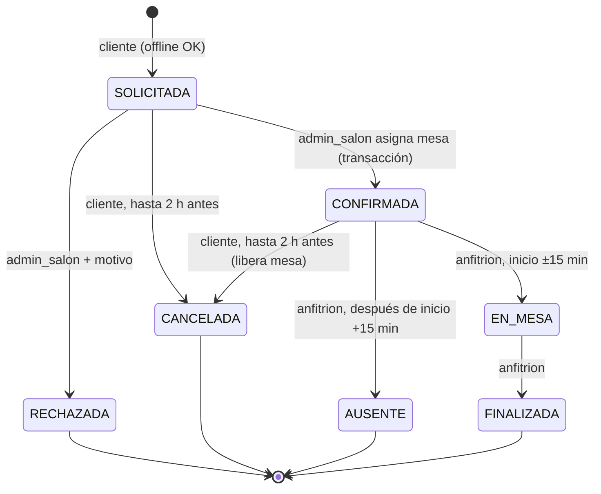
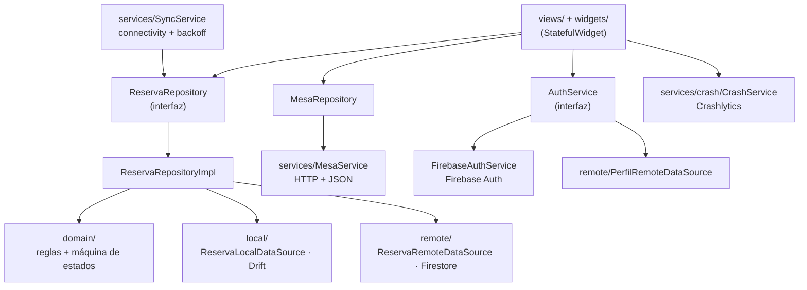

# G62-2 · Reservas gastronómicas y recepción

Proyecto final · Desarrollo Móvil · Universidad de Medellín · 2026-2 · Grupo G62

## Integrantes

- Ximena Ruiz Arias
- Víctor Manuel Monsalve Aguilar

**Versión entregada:** `1.0.0+1` (ver `pubspec.yaml`)

## Descripción

App Flutter (Android) para gestionar reservas de grupos en un restaurante: el
cliente solicita una reserva, el administrador de salón asigna una mesa y la
confirma, y el anfitrión registra la llegada, la finalización o la ausencia
durante el servicio.

La solicitud se guarda primero en el teléfono (Drift) y después se sincroniza
con Cloud Firestore. Las decisiones que ocupan una mesa (confirmar, cancelar,
bloquear) solo se hacen con conexión y dentro de una transacción.

## Roles

| Rol | Valor en `users/{uid}.rol` | Acciones en la app | Lo que imponen las reglas de Firestore |
|-----|----------------------------|--------------------|-----------------------------------------|
| Cliente | `cliente` | Ver mesas, solicitar (1–8 personas, franja futura), ver sus reservas, cancelar hasta 2 h antes, corregir o descartar un intento rechazado | Solo crea reservas a su nombre en `SOLICITADA`, solo lee las suyas, solo cancela las suyas dentro del plazo y libera la mesa en la misma transacción |
| Administrador de salón | `admin_salon` | Tablero por día y franja, asignar mesa válida y confirmar, rechazar con motivo, bloquear/desbloquear mesas | Confirmar exige capacidad ≥ personas, que el `slot` no existiera y que se cree en la misma escritura; rechazar exige motivo |
| Anfitrión | `anfitrion` | Servicio del día, registrar llegada (±15 min), finalizar, marcar ausente (+15 min) | `EN_MESA` solo dentro de la ventana según `request.time`; `FINALIZADA` exige `EN_MESA`; `AUSENTE` solo después de 15 min |

El usuario que se registra queda siempre como `cliente`. Los roles
privilegiados se asignan a mano en Firebase Console (campo `rol` del documento
`users/{uid}`) o con el script de datos de prueba. Las reglas impiden que un
usuario cambie su propio rol o cree su perfil con un rol distinto de `cliente`.

## Estados



Los estados terminales no se reactivan. La tabla de transiciones vive en un solo
archivo, [lib/domain/reserva_state_machine.dart](lib/domain/reserva_state_machine.dart),
y está replicada en [firestore.rules](firestore.rules).

Una reserva activa cuya hora ya pasó se muestra como **vencida** (por ejemplo
`Confirmada · vencida`), pero su estado del negocio no cambia solo: alguien con
el rol correspondiente debe decidir.

## Reglas de negocio

| # | Regla | App | Firestore |
|---|-------|-----|-----------|
| 1 | Reserva futura, 1 a 8 personas, franjas fijas de 90 min (12:00, 13:30, 15:00, 18:00, 19:30, 21:00) | `ReservaRules.validarSolicitud` | `creacionValida()`: `personas` 1–8, `inicio > request.time`, inicio múltiplo de 30 min |
| 2 | Solo se asigna una mesa con capacidad suficiente y sin bloqueo ni reserva en la franja; confirmar y ocupar es atómico | `ReservaRules.mesasValidas` + transacción en `FirestoreReservaRemoteDataSource.confirmar` | `adminConfirma()`: `mesaCapacidad >= personas`, `!exists(slot)` y `getAfter(slot).reservaId == reserva` |
| 3 | El cliente no puede tener dos reservas confirmadas en la misma franja; cancelar libera la mesa | `ReservaRules.tieneReservaEnFranja` + candado `cliente_franja/{uid_franja}` | `adminConfirma()` exige que el candado no existiera; `clienteCancela()` exige borrar slot y candado |
| 4 | Llegada desde 15 min antes hasta 15 min después del inicio; finalizar exige `EN_MESA`; ausente/finalizada no se reactivan | `ReservaRules.dentroDeVentanaLlegada`, `puedeMarcarAusente`, `puedeFinalizar` | `hostRegistraLlegada()`, `hostFinaliza()`, `hostMarcaAusente()` con `request.time` |
| 5 | Administración bloquea mesas por franja | `bloquearMesa` (transacción) | `slots` tipo `bloqueo` + `bloqueos/{id}` creados juntos |

Cada regla es una función pura en [lib/domain/reserva_rules.dart](lib/domain/reserva_rules.dart)
que recibe la hora (`now`) como parámetro, por eso se pueden probar sin depender
del reloj. Los errores del negocio son excepciones tipadas
([lib/domain/reserva_exception.dart](lib/domain/reserva_exception.dart)) con el
mensaje listo para la interfaz.

## Arquitectura



- Las pantallas solo hablan con repositories. Ningún widget importa Drift,
  Firestore ni `http`.
- `main.dart` crea todas las dependencias una vez y las pasa por constructor
  (`AppDependencies`), igual que el patrón `Repository(local, remote)` de BOLETAS.
- `ReservaRemoteDataSource` es una interfaz: la app usa
  `FirestoreReservaRemoteDataSource` y las pruebas usan un fake en memoria.

## Estructura

```
firestore.rules                     reglas de seguridad (se despliegan con firebase deploy)
firebase.json / .firebaserc         proyecto reservas-g62-2 (Firestore + Hosting)
hosting/api/mesas.json              catálogo HTTP de mesas (8 mesas ficticias)
tool/seed/seed.mjs                  datos de prueba (cuentas, roles, reservas)
lib/
  main.dart                         Firebase, Crashlytics, dependencias y tema
  firebase_options.dart             generado por flutterfire (solo Android)
  core/
    app_logger.dart                 logger único (debug / warning / error -> Crashlytics)
    app_constants.dart              URL del catálogo, timeouts, límites del caso
    app_dependencies.dart           contenedor de dependencias
    formatters.dart                 fechas en español
  domain/
    reserva_state_machine.dart      canTransition(from, to, rol)
    reserva_rules.dart              reglas 1–4 como funciones puras
    reserva_exception.dart          errores del negocio tipados
  models/                           Mesa, Reserva, Franja, Ocupacion, Perfil, Rol, EstadoReserva
  services/
    auth_service.dart               AuthService (interfaz) + FirebaseAuthService
    crash/                          CrashService: Crashlytics en Android, stub en web
    mesa_service.dart               petición HTTP + ApiException
    preferences_service.dart        SharedPreferences (filtro y tema)
    sync_service.dart               reenvío de pendientes con backoff
  local/
    reservas_table.dart             tabla Drift
    app_database.dart               base reservas_g62.sqlite (schemaVersion 1)
    app_database.g.dart             generado por build_runner
    reserva_local_data_source.dart
  remote/
    reserva_remote_data_source.dart          interfaz
    firestore_reserva_remote_data_source.dart  transacciones
    perfil_remote_data_source.dart
  repositories/
    mesa_repository.dart            cache en memoria del catálogo
    reserva_repository.dart         interfaz para la UI
    reserva_repository_impl.dart    coordina Drift + Firestore
  validators/
    auth_validators.dart            validaciones del formulario (funciones puras)
  views/
    auth/                           login/registro y AuthGate (restaura sesión)
    home_shell.dart                 navegación por rol
    cliente/                        mesas, nueva reserva, mis reservas, detalle
    admin/                          tablero de asignación y selector de mesa
    anfitrion/                      tablero de recepción
  widgets/                          LoadingView, EmptyView, ErrorView, EstadoChip, SyncBadge, ...
test/                               reglas, repository (Drift en memoria + fake remoto), HTTP, widgets
docs/                               matriz de pruebas, backlog de bugs, guion de sustentación
```

## Cómo ejecutar

Requisitos: Flutter 3.44 o superior (Dart 3.12), Android SDK con un emulador o
teléfono, Firebase CLI y FlutterFire CLI.

1. Instalar dependencias:

   ```
   flutter pub get
   ```

2. Generar el código de Drift (solo si se cambia la tabla; `app_database.g.dart` ya viene incluido):

   ```
   dart run build_runner build --delete-conflicting-outputs
   ```

3. Configurar Firebase (ya está hecho para `reservas-g62-2`; solo si se usa otro proyecto):

   ```
   firebase login
   dart pub global activate flutterfire_cli
   flutterfire configure --project=<PROJECT_ID> --platforms=android
   firebase deploy --only firestore:rules,hosting --project <PROJECT_ID>
   ```

   En Firebase Console: Authentication → Comenzar → habilitar **Correo
   electrónico/contraseña**.

4. Cargar datos de prueba (opcional, ver abajo) y ejecutar:

   ```
   flutter run
   ```

5. Pruebas y análisis:

   ```
   flutter analyze
   flutter test
   ```

6. APK release:

   ```
   flutter build apk --release
   ```

   Salida: `build/app/outputs/flutter-apk/app-release.apk`.

## Firebase

- Proyecto: `reservas-g62-2` (solo Android, `applicationId co.edu.udem.reservas_g62`).
- `android/app/google-services.json` y `lib/firebase_options.dart` son
  configuración de cliente (no son secretos); la protección real son las reglas.
- Colecciones:

| Colección | Id | Contenido |
|-----------|----|-----------|
| `users` | uid de Auth | `uid, email, nombre, rol, createdAt` |
| `reservas` | uuid creado en el teléfono | `clienteUid, clienteNombre, personas, inicio, franjaId, dia, comentario, estado, mesaId, mesaNombre, mesaCapacidad, slotId, motivoRechazo, llegadaAt, finalizadaAt, decididoPor, atendidoPor, createdAt, updatedAt, version` |
| `slots` | `mesaId_franjaId` | ocupación de una mesa en una franja (`tipo: reserva \| bloqueo`) |
| `cliente_franja` | `clienteUid_franjaId` | candado de la regla 3 |
| `bloqueos` | `mesaId_franjaId` | motivo y actor de cada bloqueo |

Las consultas usan un solo filtro de igualdad (`clienteUid` o `dia`), así que no
se necesitan índices compuestos.

## Endpoint HTTP

Catálogo de mesas publicado en Firebase Hosting del mismo proyecto:

| URL | Uso |
|-----|-----|
| `https://reservas-g62-2.web.app/api/mesas.json` | catálogo normal (8 mesas) |
| `https://reservas-g62-2.web.app/api/mesas_vacio.json` | QA: respuesta vacía |
| `https://reservas-g62-2.web.app/api/mesas_invalido.json` | QA: JSON inválido |
| `https://reservas-g62-2.web.app/api/no_existe.json` | QA: HTTP 404 |

La URL está en `AppConstants.catalogoMesasUrl` y se puede cambiar sin tocar
código: `flutter run --dart-define=CATALOGO_URL=<url>`.

Formato: `[{ "id", "nombre", "capacidad", "ubicacion", "caracteristicas": [] }]`.
El catálogo es solo referencia: la disponibilidad real de cada mesa está en
Firestore (`slots`), así una respuesta vieja del catálogo nunca autoriza una
asignación.

`MesaService` maneja timeout (10 s), falta de conexión, 404, 5xx, otros códigos
y JSON inválido con mensajes claros (`ApiException`), sin mostrar trazas.
`MesaRepository` reutiliza la petición en curso y la guarda en memoria, para no
repetirla en cada reconstrucción de los widgets.

## Local-first y sincronización

Operación que funciona sin conexión: **solicitar una reserva**.

1. Se valida la regla 1 y que el cliente no tenga otra reserva activa en la franja.
2. Se crea el id (`uuid v4`) **antes** del primer envío y se guarda en Drift con
   `pendingSync = true`.
3. La lista "Mis reservas" lee Drift, así que la reserva aparece de inmediato
   con el estado del negocio (`Solicitada`) y, aparte, el estado de
   sincronización (`Pendiente de envío`).
4. Se intenta crear en Firestore con una transacción: si el documento ya existe
   (un envío anterior sí llegó) **no se sobrescribe**; se adopta la versión del
   servidor. Así un reintento nunca pisa una confirmación o un rechazo.
5. Solo con la confirmación remota se marca `pendingSync = false`, y solo si
   `localVersion` es la misma que se envió (una edición posterior no queda
   marcada por la respuesta de un envío anterior).
6. Fallo temporal (sin red, timeout): queda pendiente con `lastError`; se
   reintenta solo al volver la red (`SyncService`, espera 5 s, 10 s, 20 s…
   máximo 2 min) o con el botón **Sincronizar pendientes** / **Reintentar envío**.
7. Rechazo del servidor (reglas): queda `syncConflict = true` con el motivo; no
   se reenvía solo. El cliente puede **Corregir** (nueva `localVersion`, mismo
   id) o **Descartar** el intento.

Confirmar, rechazar, cancelar, bloquear y las acciones del anfitrión requieren
conexión: se ejecutan en transacciones que releen el estado del servidor, validan
la versión (`version`, control optimista) y la máquina de estados antes de escribir.

El cliente escucha sus reservas en Firestore (`snapshots`) y copia los cambios
en Drift; el tablero del admin y el del anfitrión escuchan las reservas y los
slots del día, así cada rol ve las decisiones de los otros sin recargar.

**Cambio de cuenta:** Drift filtra siempre por `clienteUid`; `syncPending(uid)`
solo envía los pendientes del usuario de la sesión; al cerrar sesión se detienen
la escucha y el `SyncService`. No se guardan contraseñas ni tokens en Drift,
SharedPreferences ni logs.

**SharedPreferences:** guarda el filtro de "Mis reservas" (Activas / Historial /
Todas) y el tema claro/oscuro.

## Crashlytics y logs

- `CrashService` (`lib/services/crash/`) encapsula Crashlytics. `configure()`
  se llama en `main.dart` después de `Firebase.initializeApp()` e instala
  `FlutterError.onError` y `PlatformDispatcher.instance.onError` para los
  errores no capturados.
- `AuthGate` asocia los reportes al uid con `setUserIdentifier` (nunca el
  correo) y lo limpia al cerrar sesión.
- `AppLogger` tiene una sola firma de error:
  `error(String message, {Object? error, StackTrace? stackTrace})`. Solo
  `error` (excepciones inesperadas) llega a Crashlytics como no fatal.
  `warning` se usa para fallos esperados (red, rechazos de reglas, credenciales
  inválidas) y no se reporta.
- Los mensajes de log nunca incluyen contraseñas, tokens, correos ni nombres;
  solo ids de reserva y códigos de error.
- El menú ⋮ tiene **Evento de prueba Crashlytics** (no fatal) y **Forzar crash
  fatal** solo con `kDebugMode`; el APK release no los muestra.

## Firma del APK

El APK release se firma con la **clave de depuración** de Android
(`signingConfig = signingConfigs.getByName("debug")` en
`android/app/build.gradle.kts`), como permite el enunciado para esta entrega
académica. Compilar en modo release (optimizado, sin `kDebugMode`) y firmar con
una clave de producción son decisiones distintas: para publicar en una tienda
habría que crear un keystore propio. No se entrega AAB.

## Datos de prueba

`node tool/seed/seed.mjs` (requiere `firebase login` y la variable
`SEED_PASSWORD`). Crea:

- 4 cuentas: `cliente@g62reservas.test`, `cliente2@g62reservas.test`,
  `admin@g62reservas.test` (`admin_salon`), `anfitrion@g62reservas.test`.
  La contraseña se comparte por el medio privado que indique el docente.
- 8 mesas en el catálogo HTTP.
- 8 reservas: 3 `SOLICITADA` (dos en la misma franja para probar concurrencia y
  una de 7 personas sin mesa válida), `CONFIRMADA`, `RECHAZADA`, `CANCELADA`,
  `FINALIZADA` y `AUSENTE`, más un bloqueo de la mesa M07.

Las fechas se calculan desde el día en que se corre el script (hora de
Bogotá): conviene correrlo el mismo día de la revisión o la sustentación para
que las solicitudes "futuras" sigan siéndolo. Es idempotente: reutiliza las
cuentas y sobrescribe las reservas `seed-*`.

`node tool/qa/reglas_check.mjs` (misma `SEED_PASSWORD`) prueba las reglas contra
el Firestore real con el token de cada cuenta: acceso entre cuentas, cambio de
rol, regla 1, mesa pequeña, doble confirmación y llegada fuera de margen. Al
terminar borra lo que creó; después se vuelve a correr el seed.

## Privacidad

- **Datos recolectados:** correo y nombre (perfil), y por cada reserva: cantidad
  de personas, franja, comentario opcional, mesa y horas de llegada/salida.
- **Finalidad:** gestionar la reserva y la atención en el restaurante.
- **Acceso por rol:** el cliente solo ve sus reservas; el administrador y el
  anfitrión ven las reservas del día (nombre del cliente, sin correo). Los
  `slots` no tienen datos personales.
- **Crashlytics:** recibe trazas de errores, modelo del dispositivo y versión de
  la app; no recibe correos, nombres, contraseñas ni tokens.
- **En el teléfono:** Drift guarda las reservas del usuario; SharedPreferences
  solo el filtro y el tema.

## Límites conocidos

- Un restaurante, una mesa por reserva, franjas fijas. No se unen mesas, no hay
  menú, cobros ni WhatsApp.
- Solo Android (`firebase_options.dart` no tiene web ni Windows).
- La capacidad de la mesa viene del catálogo HTTP y viaja en la confirmación
  (`mesaCapacidad`); las reglas la comparan con `personas`, pero no pueden leer
  el catálogo HTTP. Un administrador malicioso podría enviar una capacidad falsa.
- Las franjas y horas se calculan en la hora del restaurante (Bogotá, UTC-5
  fijo, `lib/core/hora_restaurante.dart`), sin importar la zona del teléfono.
  Las ventanas de llegada y cancelación usan el reloj del teléfono en la app y
  `request.time` en las reglas; si el reloj está muy desfasado, la regla del
  servidor manda.
- El catálogo se guarda en memoria, no en Drift: sin conexión, la pestaña Mesas
  muestra error con Reintentar (la solicitud sí funciona sin conexión).

## Preguntas

1. **¿Para qué sirve `pendingSync`?**

   Es la marca que dice si la solicitud ya llegó a Firestore. Al guardar queda
   en `true` y solo pasa a `false` cuando Firestore confirma la creación. Con
   ella "Sincronizar pendientes" sabe qué enviar, y la interfaz muestra
   "Pendiente de envío" aparte del estado del negocio, para que una solicitud
   que no ha llegado nunca parezca confirmada. Junto a ella están `lastError`
   (último motivo de fallo), `syncConflict` (el servidor la rechazó, no se
   reenvía sola) y `localVersion` (para no marcar sincronizada una edición más
   reciente que la enviada).

2. **¿Por qué se guarda primero en Drift?**

   Para que la solicitud no se pierda aunque no haya internet o Firebase falle.
   Drift escribe en el teléfono y no depende de la red, así que el cliente
   siempre puede solicitar. Después se intenta Firestore. Si fuera al revés y la
   red fallara, la solicitud se perdería.

3. **¿Qué función cumple el Repository?**

   Es la única puerta de las pantallas hacia los datos. La pantalla pide
   "solicitar", "cancelar" o "confirmar" y el repository decide cómo: valida las
   reglas, guarda en Drift, llama a Firestore, marca sincronizado y traduce los
   errores. Las pantallas no conocen Drift, Firestore ni HTTP, y en las pruebas
   se reemplaza Firestore por un fake sin tocar la interfaz.

4. **¿Qué pasa si Firebase falla?**

   La solicitud ya quedó en Drift, el error se captura en el repository, la app
   no se cae y la reserva sigue con `pendingSync = true` y el motivo en
   `lastError`. Al volver la red se reenvía sola (o con el botón). Como el
   documento usa el mismo uuid, reenviarla no crea duplicados. Las acciones que
   ocupan mesa (confirmar, cancelar) no se guardan offline: muestran "Esta acción
   necesita conexión" y no cambian nada.

5. **¿Cómo se evita que dos administradores asignen la misma mesa?**

   Cada mesa en cada franja tiene un documento con id fijo `slots/{mesa_franja}`.
   Confirmar es una transacción que lee ese slot y la reserva, y solo si el slot
   no existe lo crea junto con el cambio a `CONFIRMADA`. Si dos transacciones
   compiten, Firestore reintenta la segunda, que ahora ve el slot ocupado y
   falla con "La mesa ya tiene una reserva confirmada". Las reglas además exigen
   que el slot no existiera antes de la escritura.

## Decisiones técnicas

- **Transacciones + documento por mesa/franja:** la forma más simple de garantizar
  que solo una confirmación gane sin Cloud Functions (el enunciado lo permite).
- **Local-first solo para la creación:** es la única operación que no consume un
  recurso compartido; las demás deben validarse contra el estado real.
- **Control optimista con `version`:** si la reserva cambió mientras el usuario
  la miraba, la acción se aborta con un mensaje en vez de pisar la decisión de
  otro rol.
- **SharedPreferences para el filtro:** es una preferencia de la vista, sin valor
  de negocio; si se pierde no pasa nada. Las reservas van en Drift.
- **Sin paquete de estado:** `StatefulWidget` + inyección por constructor, como
  en los proyectos de clase; el estado compartido vive en Drift (streams) y
  Firestore (snapshots).

## Documentación de QA

- [docs/matriz_pruebas.md](docs/matriz_pruebas.md) · matriz ejecutada
- [docs/bugs_backlog.md](docs/bugs_backlog.md) · defectos encontrados
- [docs/sustentacion.md](docs/sustentacion.md) · guion para explicar el código
- [docs/evidencia/](docs/evidencia/) · capturas del APK y log de Crashlytics citados en la matriz
- `tool/qa/reglas_check.mjs` · prueba las reglas contra el Firestore real con las cuentas de cada rol

## Checklist de release

Se marca solo lo comprobado sobre la build 1.0.0+1 (detalle y evidencia en la matriz).

- [x] Autenticación, tres roles y reglas Firestore comprobados. *Registro, login, errores y cambio de cuenta en el APK release (CP-01, CP-02, CP-04); 16 casos de reglas contra el Firestore real con el token de cada rol (CP-03, CP-15).*
- [x] Flujo completo, estados de interfaz y reglas de negocio validados. *Los tres roles recorridos en el APK release: solicitar, confirmar con mesa valida, cancelar con liberacion de mesa, llegada en ventana, finalizar y ausencia (CP-09 a CP-16, CP-20).*
- [x] Drift, cambio de cuenta, pendientes y reintentos sin duplicados comprobados. *Guardado sin conexión, persistencia tras reiniciar y sincronización con un solo documento en el APK release (CP-08 a CP-10); aislamiento por cuenta (CP-04); 12 tests del repository.*
- [x] Crashlytics verificado; logs y permisos revisados. *Evento de prueba visible en la consola, versión 1.0.0 (CP-17); opción de prueba ausente en release; permisos INTERNET y ACCESS_NETWORK_STATE; logs sin correos ni claves.*
- [x] Versión actualizada; APK release instalado y probado. *`G62-2_Reservas_v1.0.0+1.apk` (1.0.0+1) instalado y recorrido con cliente, administrador y anfitrion (CP-18).*
- [x] Código, README, datos de prueba y matriz QA listos para revisión. *`flutter analyze` sin issues, `flutter test` 56/56, evidencia en `docs/evidencia/`.*
